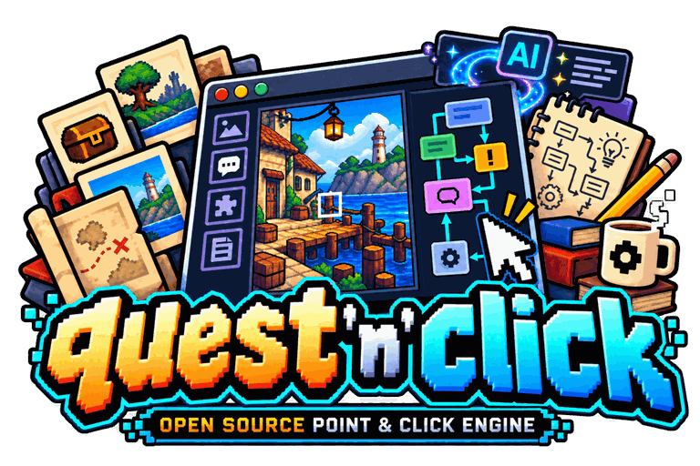
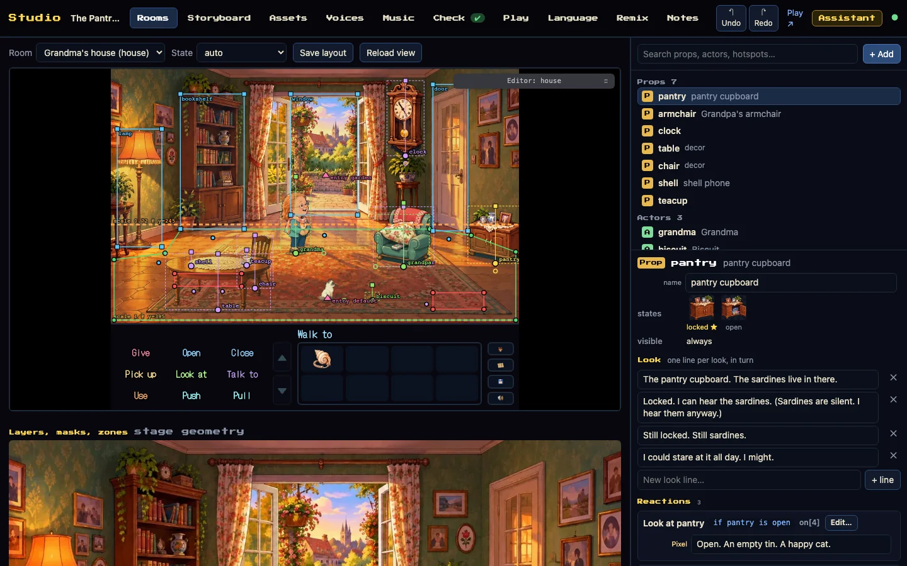
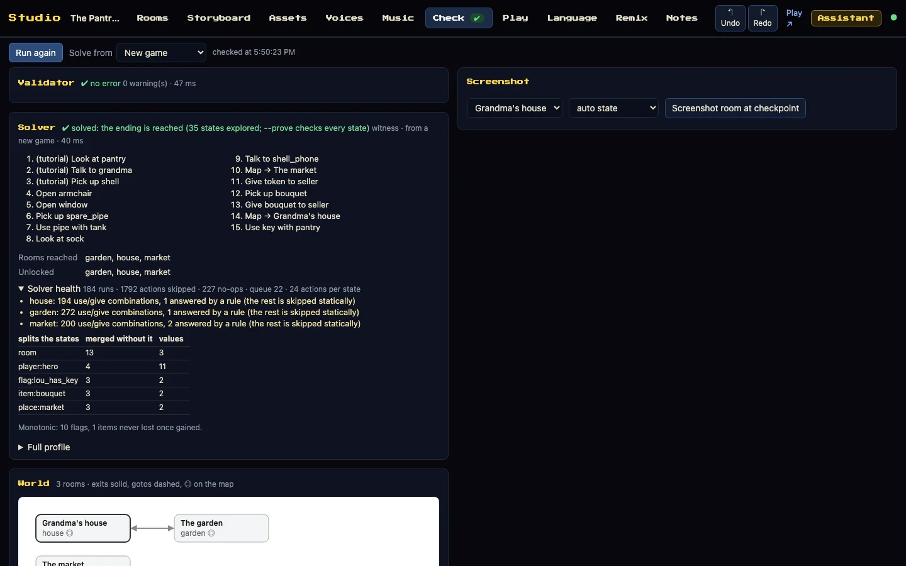
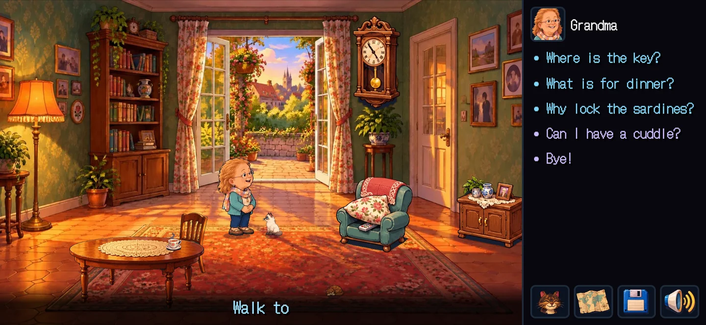
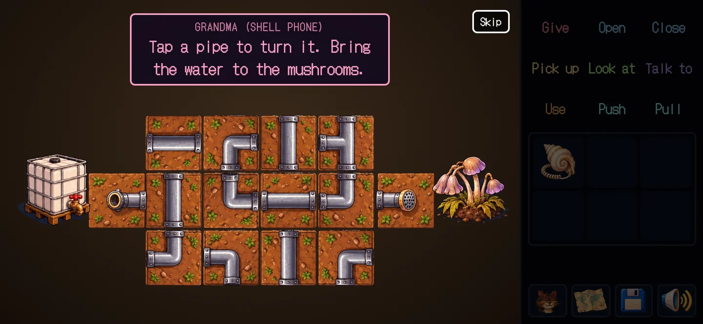

<p align="center"></p>

# quest'n'click

**Make a point-and-click adventure for the browser: write it as data, shape it in a visual Studio, check that it can
be finished, and ship it as a web game that installs on a phone and plays offline.**

*[Version française](README.fr.md)*

> **Formerly web-scumm.** This project was called WebSCUMM, then web-scumm, in homage to SCUMM, the LucasArts engine
> whose spirit it follows. It was renamed quest'n'click so its name would spark no needless debate. Links to the old
> repository redirect here, and the old demo address, `wanoo.github.io/web-scumm`, redirects to the new one: the game
> and the Studio now live at [wanoo.github.io/quest-n-click](https://wanoo.github.io/quest-n-click/). From 4.2.5 the packages and commands
> are named `quest-n-click`; the old `web-scumm` names kept working through 4.2.x and are gone in 4.3.0, where
> `npx quest-n-click migrate` renames a game's imports and commands
> ([UPGRADING](docs/en/UPGRADING.md#39-from-425-to-430-hero-choice)). Saves, runs and sessions keep their formats and load as before.

| | |
|---|---|
| 🎮 **Play** | [The Pantry Key](https://wanoo.github.io/quest-n-click/), the sample game, on a phone in landscape or on a desktop |
| 🛠 **Studio** | [Open the Studio](https://wanoo.github.io/quest-n-click/studio.html) in demo mode: edit the sample game, your edits stay in your browser |
| ⏱ **Start** | [Your own game in its own folder](#start), then [a first room in fifteen minutes](docs/en/TUTORIAL.md) |


## Start

<!-- install:begin -->
Node 22.12 or newer and Python 3 with Pillow (`npm run assets` prepares the art with them), on Windows, macOS or
Linux. The engine installs from a release's archive (npm publishing comes
in a later release):

```bash
T=https://github.com/wanoo/quest-n-click/releases/download/v4.3.1/quest-n-click-4.3.1.tgz
npx --package=$T quest-n-click create my-game "My Game" --engine=$T
cd my-game && npm install
npm run assets && npm run dev        # play it; then npm run verify, npm run build
```
<!-- install:end -->

`npm run build` writes `dist/`, a static site any host serves. ffmpeg serves the sound pipeline and is optional;
`npx quest-n-click doctor` says what is missing. [PACKAGE](docs/en/PACKAGE.md) is the whole guide;
[TUTORIAL](docs/en/TUTORIAL.md) walks the first room.
Before 4.2.5 the archive and the command were named `web-scumm`; 4.2.5 also shipped them under that name, and 4.3.0
no longer does: a game made before moves with `npx quest-n-click migrate` ([UPGRADING](docs/en/UPGRADING.md#39-from-425-to-430-hero-choice)).

## Build a game

**The content is data.** Rooms, props with states, characters, items, rules, conversations, hints, scripts and
events are plain TypeScript objects, with no code in them, so every tool can read, check and play them:

```ts
export const garden: RoomDef = {
  id: 'garden', name: 'The garden', decor: 'garden',
  props: { tank: { name: 'water tank', states: { full: 'tank_full', empty: 'tank_empty' } } },
  exits: { back_door: { name: 'back door', to: 'house', entry: 'garden' } },
  on: [
    { verb: 'use', a: 'pipe', b: 'tank', if: '!tank_drained',
      do: [{ minigame: 'pipes' }, { lose: 'pipe' }, { set: 'tank_drained' }, { prop: ['tank', 'empty'] }] },
  ],
  hints: [{ until: 'tank_drained', lines: ['Use the pipe on the water tank.'] }],
};
```

A rule is a verb, a target, a condition and a list of commands. What a game needs beyond them, a custom command, is
TypeScript of its own: trusted code, named in the game and hashed with it ([CONTENT_GUIDE](docs/en/CONTENT_GUIDE.md),
[ENGINE](docs/en/ENGINE.md)). Famous mechanics of the genre are written this way in [CLASSICS](docs/en/CLASSICS.md).

**The Studio is the real engine with an editor on top**: rooms with their placements, the storyboard panel by panel,
every sprite sheet and where it is used, the checks after every save, a play tab that explains a rule and replays a
session, and notes shared with an AI assistant ([STUDIO](docs/en/STUDIO.md)).

<table>
<tr><td width="50%" valign="top"><br><sub><b>Rooms</b>: the real engine, a placement editor on top, every line editable in place</sub></td><td width="50%" valign="top"><br><sub><b>Check</b>: the validator and the solver, run again after every save</sub></td></tr>
</table>

**Art, sound and languages.** A prompt for every sprite sheet, object and backdrop in one style, sheets cut into
sprites ([PROMPTS](docs/en/PROMPTS.md)); chip-tune music arranged from a MIDI and sound effects from one palette
([AUDIO](docs/en/AUDIO.md)); every line translatable, a missing translation found before release.

## Prove and ship it

- **Validated**: broken references, unreachable rooms and untranslated lines are found before anyone plays.
- **Solved**: the solver runs the real engine (no second model of the content). `npm run verify` asks for a
  **witness**, a path to an ending; `npx quest-n-click solve --prove` explores **every reachable state** and fails on a softlock or a truncated search. These
  are two different promises, and the release asks for the second ([BENCH](docs/en/BENCH.md) says what the proof can
  and cannot do).
- **Replayed**: a session is the unit of reproduction; saves load across versions, one frozen save per release from
  3.0.0 on.
- **Shipped**: a PWA that installs and plays offline after the first visit, with what a phone has to download held by
  a budget and every file accounted for with its licence.
- **Accessible as far as a machine can tell**: axe-core on every screen, keyboard and touch play in CI. That is not a
  WCAG conformance claim: screen-reader and real-device passes are a person's to make ([FIELD](docs/en/FIELD.md)).

<table>
<tr><td width="50%" valign="top"><br><sub>Conversations with topics, choices and a transcript</sub></td><td width="50%" valign="top"><br><sub>The puzzle graph: what each item and flag leads to, the critical path, the solver's heat</sub></td></tr>
</table>

## Further

- **Several playable characters**, a world map, minigames playable by touch or keyboard, cutscenes and phone calls,
  autosave and save slots.
- **Remix**: worlds generated from a seed, each one validated and solved before it ships ([REMIX](docs/en/REMIX.md)).
- **Speedrun**: runs recorded, sealed and verified by a replay; leaderboards on the Bridge.
- **Reality**: a game reacts to a fact from the world (an email answered, a terminal command, a badge) through a
  signed signal from a Bridge, without its content touching the network ([REALITY](docs/en/REALITY.md),
  [REALITY-OPS](docs/en/REALITY-OPS.md)).

<table>
<tr><td width="50%" valign="top"><br><sub>A minigame, played by touch or with the keyboard</sub></td><td width="50%" valign="top"><br><sub>The world map, the characters where they are</sub></td></tr>
</table>

## What is stable

Each surface is promised only as far as its proofs go ([SUPPORT](docs/en/SUPPORT.md), [GO / NO-GO 4.2](docs/dev/GO-NO-GO-4.2.md)):

| Stable | Limited | Experimental |
|---|---|---|
| the content format and its tools; the desktop Chromium PWA; the Reality Bridge on SQLite | the DOM player on phones and screen readers (untried by a person); the Safari PWA; Firefox (the PWA only); speedrun and Remix; voices; the four package archives (until a person installs them) | the Canvas painter; the Bridge on Postgres (`distributed`); the four connectors |

What only people and real devices can check is listed, not claimed: [FIELD](docs/en/FIELD.md), and each release's
notes say which passes were made.

## How it is made

```
src/engine/      core (the DSL, the engine), tools (validate, solve, lint, i18n…), dom (the player), minigames, reality
games/demo/      the sample game: rooms, layouts, art, audio, locales, storyboard
games/_template/ copied by npm run new-game
tools/           the commands, the Studio, the MCP server, the art and audio pipelines, the Vite plugins
bridge/          the Reality Bridge (the package quest-n-click-bridge)
connectors/      the connectors of the world outside (the package quest-n-click-connectors)
docs/en docs/fr  the documentation; docs/dev: the work log, the decisions, each release's passes
```

The engine, the solver and the replay share one code path; [ARCHITECTURE](docs/en/ARCHITECTURE.md) and a half-hour
[CODE_TOUR](docs/en/CODE_TOUR.md) explain how it fits together.

**Made with an AI assistant, reviewed by people.** The content is declarative, so an assistant reads and writes it
like any other file (`AGENTS.md` holds the rules); every operation is a command and an MCP tool
([MCP](docs/en/MCP.md)); after each change it can validate, solve, replay and take a screenshot, so it sees its own
mistakes before a person does. Every result stays reviewable, in the Studio and in Git.
[CONTRIBUTING](CONTRIBUTING.md) says how to change it.

## In numbers

Measured on this commit of `main` by the automated gates (`npm run quality:baseline` writes these figures):
<!-- metric:tests -->2944<!-- /metric --> unit test declarations, on Node 22 and 24, with coverage floors and gated
mutation testing; the reference game proved in <!-- metric:referenceStates -->288<!-- /metric --> states; the player's
first visit <!-- metric:initialJsKB -->135<!-- /metric --> KB of JavaScript, gzipped. Each release is built from the
commit its candidate tested. The candidate makes the four package archives, the Bridge's image, the SBOMs, the runs and
the baseline, and the release publishes those very files; the release makes only the built game, its assets manifest,
the proved Remix catalogues, the reference speedrun and the sums, from the same commit. Every file is published with
its SHA-256 sum and a provenance attestation ([the list](tools/release/artifacts.mjs)).

## Documentation

Every page exists in English (`docs/en/`) and French (`docs/fr/`), and a test keeps the two in step: the
[TUTORIAL](docs/en/TUTORIAL.md), the [WORKFLOW](docs/en/WORKFLOW.md) from the first idea to the release, every
command in [TOOLS](docs/en/TOOLS.md), what changed in the [CHANGELOG](CHANGELOG.md), moving to a new version in
[UPGRADING](docs/en/UPGRADING.md), and where it comes from in the [ROADMAP](docs/en/ROADMAP.md).

Current release: [v4.3.1 (Voices by Language)](https://github.com/wanoo/quest-n-click/releases/tag/v4.3.1): a translation's own text
switches get their voices by value through the whole chain, and `npm run solve` is said to find one winning path
(`--prove` proves every hero). Over 4.3.0 "Hero Choice": the player
chooses the hero at New Game (portraits in a choice, a name per variant, text switches so the others' words follow the
hero), a key per verb and a proportional pixel font for the interface, most of it from an outside contributor, Horacio
(LostInBrittany); the former `web-scumm` names are gone (`npx quest-n-click migrate`). Over 4.2.5, the project's new
name; 4.2.4's changes for authors (an exit gone
through on a single tap, `actorGap`, the sprite sheets' background, `face: 'hero'` fixed) and 4.2.3 "Coordination",
the Studio online for a team, experimental ([STUDIO-SERVER](docs/en/STUDIO-SERVER.md)): previews per revision, health, personal undo, published builds, backup and restore, and since 4.2.3 a scenario map, anchored
comments, a diff by name, AI agents through a remote MCP, Git push and import, the hosted Assets tab; over 4.2.0 "Stable
World". 4.2.0 restored strict SemVer after the 4.1.x incubation line: a minor adds, a major removes; the public API
follows it ([SUPPORT](docs/en/SUPPORT.md)). 4.2.0 shipped before the people's passes: of the surfaces above, only the
Stable column is promised; the passes are made on a 4.2.x, which promotes what they prove
([GO / NO-GO 4.2](docs/dev/GO-NO-GO-4.2.md), D38).

## Licences

Code: MIT. Sample artwork, sound effects and theme: CC BY 4.0 (attribution "Wano"); the theme is Tchaikovsky's *Swan
Lake* (public domain), written out and arranged for the project. Fonts: SIL OFL. See `CREDITS.md`.

quest'n'click (formerly web-scumm) is an independent project. "SCUMM-style" names a kind of game; the project is not affiliated with, endorsed
by or derived from LucasArts, Lucasfilm, Disney or the ScummVM project, and ships none of their code, data or art.
